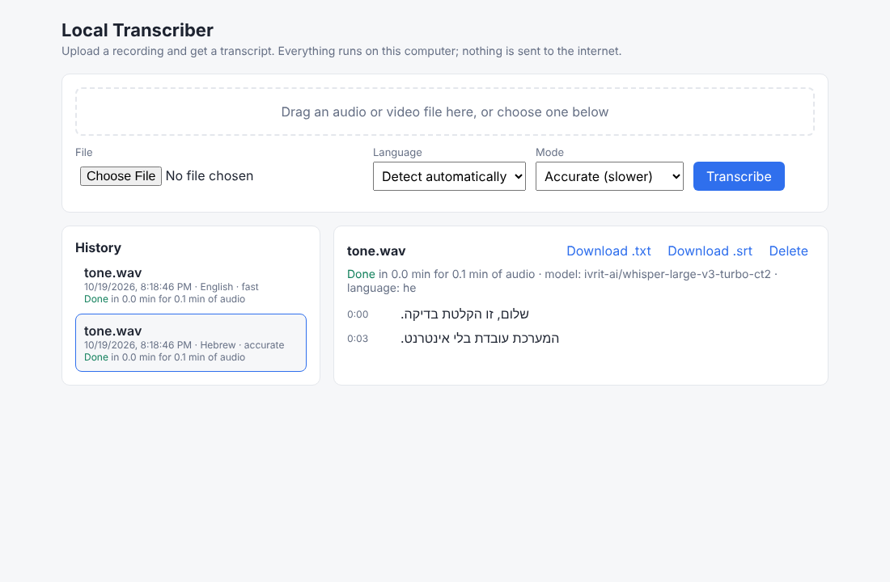

# Local Transcriber

Upload a recording and get a transcript in Hebrew or English. It runs entirely on your own computer: no cloud, no subscription, and the audio never leaves the machine.



**30-second pitch:** "Teams record meetings and interviews but can't send sensitive audio to cloud services. I built a free, offline transcription tool. Before building it I ran a pilot comparing three Whisper models on public Hebrew and English audio, measuring accuracy and speed on an ordinary laptop, and picked the models based on those numbers."

## What it does (v1)
- Upload audio or video (mp3, wav, m4a, mp4 and more), or drag it onto the page.
- Choose a language (auto, Hebrew, English) and a mode (Fast or Accurate).
- Jobs run in the background one at a time, with a progress bar; the text appears as it's transcribed.
- Download the result as `.txt` (with timestamps) or `.srt` (subtitles).
- History of past transcripts, kept on disk and still there after a restart.

| Mode | Model | Use it when |
|---|---|---|
| Fast | Whisper `small` | You need a quick draft |
| Accurate, English/auto | Whisper `large-v3-turbo` | Normal use |
| Accurate, Hebrew | `ivrit-ai/whisper-large-v3-turbo-ct2` (Whisper fine-tuned on Hebrew) | Hebrew recordings |

## Install on Windows (one time)
1. Install **Python 3.10 to 3.12** from python.org and tick **"Add python.exe to PATH"**.
2. Double-click **`setup.bat`**. It creates a private environment and installs the app (a few minutes).
3. Double-click **`download-models.bat`**. It downloads the models (about 3.5-4 GB; needs internet this once).

## Use it
Double-click **`start.bat`**. The browser opens at http://localhost:8000. Close the black window to stop it.

After step 3 the app works with Wi-Fi off. Recordings and transcripts are stored in the `data` folder next to the app.

**Speed on a 4-core laptop CPU (estimate, to be confirmed by the pilot):** Fast takes roughly 15-25 minutes per hour of audio; Accurate takes roughly 40-70 minutes per hour.

## Pilot test (measure accuracy and speed)
1. Get a few public clips that come with correct text:
   - English: LibriSpeech "test-clean" (openslr.org/12)
   - Hebrew: Google FLEURS Hebrew or Mozilla Common Voice Hebrew
2. Put them in a folder, each clip with a `.txt` file of the same name holding the correct text (`clip01.wav` + `clip01.txt`).
3. Run:
   ```
   .venv\Scripts\python -m transcriber.benchmark C:\path\to\clips\he --language he --out results-he.csv
   ```
   For each model it prints the **word error rate** (share of words wrong; lower is better) and **minutes of processing per hour of audio**, and saves everything to a CSV you can open in Excel.

## How it's built
- `transcriber/main.py`: the web server (FastAPI) and the upload page in `static/index.html`
- `transcriber/jobs.py`: the queue and history (one folder per recording under `data/jobs`)
- `transcriber/engine.py`: runs Whisper with faster-whisper on the CPU (int8)
- `transcriber/config.py`: which model each choice uses, and CPU settings
- `transcriber/benchmark.py`: the pilot test

Tests: `pip install pytest httpx`, then `python -m pytest`. They use a stand-in engine (`TRANSCRIBER_FAKE=1`), so no model is needed.

## Not in v1
Live transcription, telling speakers apart, user accounts, cloud. A possible v2 is sending the transcript to a local Ollama model for a summary and action items.
